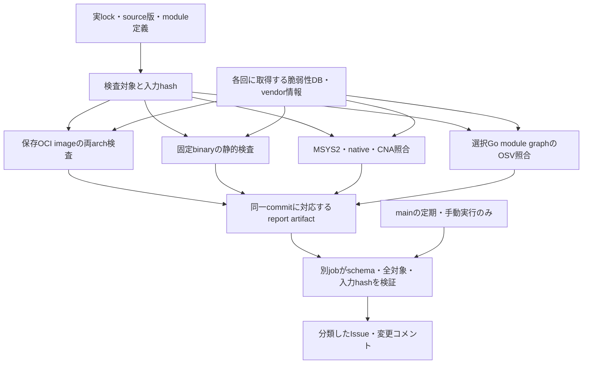

# 固定した入力の脆弱性検知と通知

固定した環境やbinaryも、同じ取得物を新しい脆弱性情報で継続して検査する。再ビルドや最新版への置換を検査の前提にしない。既存のDependabot、npm audit、gosec、govulncheck、配布imageのTrivy検査は維持する。

## 検査する実体

| 対象 | 取得元・検査方法 |
| --- | --- |
| Ubuntu・Alpine builder/runtime | consumer lockのOCI digestを直接Trivyで検査。amd64/arm64を別々に指定する |
| BuildKit・SBOM生成image | Docker lockのdigestを直接検査。Dockerfileに追加された外部base imageも自動で登録する |
| Docker Engine同梱のcontainerd/runc、Buildx、Compose、Trivy、GitHub CLI、Grype、ORAS | SHA256を照合したbinaryを展開し、Trivyで埋込Go module・Go版を静的解析する。製品binaryを実行しない |
| MSYS2全package | 保存済みOCI artifactからhash検証したpackages.txtだけを取得。公式SRCINFOとCycloneDXのCPE/PURLを使い、保存していた版のSBOMをGrypeで検査する |
| OpenSSL・Tcl・Node・Xcode | 実際のsource lock・版定義からCPE付きSBOMを作り、Grypeで照合する |
| SQLCipher・CI用WebView2 Runtime | NVDの製品keywordに一致するCVEを収集し、CVE CNAの製品名・version範囲で照合する。判定不能な記法・製品名はAdvisory要確認Issueにする。Edgeの版をWebView2の版として扱わない |
| アプリとGo製CIツール | 通常のgo.mod/sum、旧gosec.mod/sum、専用tool moduleを自動検出し、選択中のmodule graphをOSVで検査する。固定版を直接取得する旧govulncheck・actionlint・Wails 2 CLIとGo標準ライブラリも対象にする |

Go検査は、過去のgo.sum全行を使用中の依存とみなさず、コピーしたmanifestから`-mod=readonly`で選んだ版を使用する。検査はCI内で行い、アプリのbuildや取得したツールの実行を必要としない。OSVの版照合は、既存govulncheckの「到達可能な脆弱性」検査と区別する。

新しいlock fileやDocker toolを未登録で追加した場合はinventory検証を失敗させる。通常のGo tool moduleとDockerfileのbase imageは追加を自動検出する。新しい独自形式を追加するときは検知方法も登録する。

## 実行と権限

`.github/workflows/pinned-input-security.yml`が毎日18:43 UTC（翌03:43 JST）のscheduleとmainの手動実行で検査する。同じrepositoryからのPRでは読み取り専用の検査を実行し、Issueは作成しない。forkのPRはローカルfixture検査だけを実行する。

scanner jobは`contents: read` / `packages: read`だけを持つ。`issues: write`を持つ通知jobは、検査対象のarchiveやprogramを実行しない。PR、fork、main以外の手動実行からIssueを作成することも拒否する。

外部Actionはfull SHA、追加したGrype/ORASは版とSHA256で固定する。Trivyは共通の既存lockを使う。DBは各jobの空のcacheへ新たに取得し、binaryとDBのidentity、raw scan、生成SBOM、vendor metadataのhashを`pinned-evidence-*` artifactへ保存する。認証設定や取得したbinary archiveは保存しない。

## 通知と合否

| 分類 | 意味 |
| --- | --- |
| 脆弱性 | package版・CPE/PURL・CNA版範囲に一致した候補。利用条件とvendorの修正を確認する |
| Advisory要確認 | 製品keywordには一致するが、製品やversion範囲を自動判定できない |
| 更新候補 | 新しいstable releaseがある。これだけで脆弱性があるとは断定しない |
| 検査範囲の不足 | 保存packageにCPE/PURL等がない、旧版の対応付けを確実に作れない、OS supportが終了した等 |
| 検査エラー | DB・feed・保存物の取得失敗、checksum/schema不一致、不完全なmodule graph、artifact欠落等 |

深刻度の低い候補や修正版未提供の候補も通知対象にする。検査が実行できなかった状態を「脆弱性なし」に変換しない。候補・未照合・検査エラーがあればscan jobは失敗する。通知はscanの失敗後も動き、reportの取得失敗自体も検査エラーIssueにする。

同じ対象・状態のIssueを毎日重複作成しない。open Issueの内容が変化したらコメントする。人がcloseしたIssueも、同じ状態なら再通知しない。advisoryや版などが変化した場合は新しいIssueにし、自動reopen・自動closeは行わない。1回25件の書込上限を超えた場合は実行を失敗させ、次回以降に残件を処理する。

OpenSSLのrelease通知は使用中のmajor/minor系列に限定する。4系への移行は自動提案・適用しない。他のversion更新も、通知を確認した更新PRとして扱い、自動でconsumer digestや取得先を差し替えない。

## 検知できる範囲

MSYS2公式の識別情報にも未対応packageがある。新しいpackage用のVEXやbackport判定を古い保存packageへ流用しない。CPE照合の候補はplatform違いやvendorのbackportによる誤検知もあり得るため、全件を実際の悪用可能性と同一視しない。未照合packageは一覧と件数を残してIssueにする。

CNAのkeyword検索とversion表記にも限界がある。NVD/CNAに未登録・未公開の脆弱性、Xcodeの全SDK構成、GitHub-hosted OS/kernelや利用者端末のOSを完全に検査する仕組みではない。これらの範囲と、既知advisoryの版照合結果は区別する。

保存環境のbase DockerfileにもDependabotの週次更新PRを有効にし、送り先は`feat/update-source-version`にする。固定PRをmainへ統合した後、その変更を更新用branchにも反映してから運用する。OS packageを含む環境の更新は #329 の生成workflowで候補を作り、package差分・上記検査・native/暗号化/E2Eを確認して、別の更新PRでconsumer lockへ採用する。

参照: [MSYS2の公式vulnerability reporting](https://www.msys2.org/dev/vulnerabilities/)、[OSV API](https://google.github.io/osv.dev/api/)、[Grype DB](https://oss.anchore.com/docs/guides/vulnerability/database/)、[Dependabotの対応ecosystem](https://docs.github.com/en/code-security/reference/supply-chain-security/supported-ecosystems-and-repositories)。
